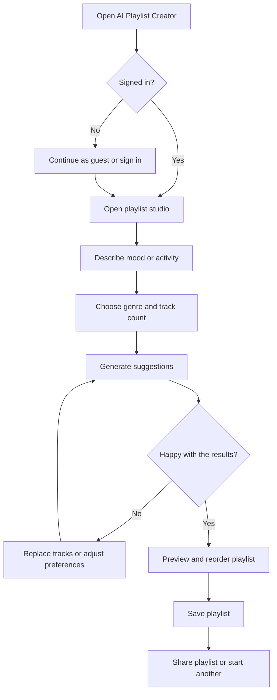

# Session 1: AI Playlist Creator

## 1. Project Summary

The AI Playlist Creator is a React app that helps people quickly make playlists for a mood, activity, or occasion. A user describes what they want to listen to, chooses a few preferences such as genre and playlist length, and receives a suggested list of songs that they can review and adjust. The app brings the convenience of music discovery together with simple playlist tools, so users can spend less time searching and more time listening. For this first version, sample song data can demonstrate the experience; a real music-catalogue or AI service can be connected later.

## 2. Core Features

1. **Mood-based playlist suggestions:** Users can describe a mood or activity and get relevant songs, making it easier to find music when they do not know what to search for.
2. **Genre and length controls:** Users can choose a genre and the number of tracks, giving them control over how closely the playlist fits their plans.
3. **Song search and replacement:** Users can search for tracks and replace suggestions they dislike, so the finished playlist feels personal.
4. **Playlist preview:** Users can review track names, artists, and order before saving, helping them catch unwanted songs and organize the listening experience.
5. **Save and share playlists:** Users can keep a playlist for later or share it with friends, making the result useful beyond a single visit.

## 3. Main User Journey



**Additional idea suggested during brainstorming:** allow users to regenerate only one disliked track instead of rebuilding the entire playlist. This preserves the songs they already like and makes editing faster.

## 4. React Implementation Plan: Mood-Based Suggestions

The feature can be implemented with a parent `PlaylistStudio` component that owns the current mood, selected genre, requested track count, generated tracks, loading status, and error message using React state. A child `MoodPromptForm` receives the mood, genre, and track-count values as props and calls callback props such as `onMoodChange`, `onGenreChange`, `onTrackCountChange`, and `onGenerate` when the user edits the form or submits it. The parent uses those values to filter or request suggestions, then stores the returned track array in state. It passes the array to `PlaylistResults`, which renders one `PlaylistTrack` per result and provides an `onReplaceTrack` callback so a track can be changed without losing the rest of the playlist.

Example shared data:

```js
const [playlist, setPlaylist] = useState([]);
const [preferences, setPreferences] = useState({
  mood: "focused",
  genre: "indie",
  trackCount: 12,
});
```

`MoodPromptForm` and `PlaylistStudio` share the preference values through props and event callbacks. `PlaylistResults` receives the playlist array and replacement callback. In the first version, `onGenerate` can select matching items from local sample data; a future version can call a protected server endpoint for an AI or music-catalogue service.

## Scope Note

This session asks for a project idea, feature list, user-flow diagram, and implementation plan. It does not require external API credentials or a deployed app.
