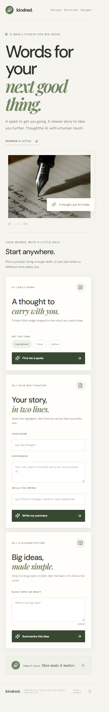

# Session 8 — Responsive and Browser QA

This folder contains the Kindred AI Writing Studio used for the responsive,
cross-browser, and Lighthouse checks in this session.

## Run locally

1. Copy `.env.example` to `.env` and add your server-side `OPENAI_API_KEY` and
   `HF_TOKEN` to test live AI requests.
2. Run `npm install` and `npm run dev`.
3. Run `npm run lint`, `npm test`, and `npm run build` for validation.

## Mobile layout screenshot

Captured in the Chrome browser at a 375 × 812 CSS-pixel iPhone X-style viewport:

## Responsive layout observations

Checked the Chrome responsive viewport at 375 × 812 (iPhone X-sized), 768 ×
1024 (tablet), and 1440 × 900 (desktop). No horizontal overflow was observed
at these widths.

- The mobile header hides the “Find a little clarity” CTA; the hero and all
  three tool cards stack into one column. The hero image moves below the text.
- Tablet shows the hero image beside the text and lays the tool cards out in two
  columns. Desktop retains the side-by-side hero but uses three tool columns and
  a wider hero image.

## Chrome and Firefox

- Chrome: checked the page at mobile, tablet, and desktop viewport sizes, and
  confirmed quote and resume forms show the missing-key error when no secrets
  are configured.
- Firefox: loaded and captured the desktop homepage in headless Firefox. No
  visible layout issue appeared compared with Chrome. Firefox logged a
  non-fatal software framebuffer warning during the screenshot, but rendered
  the page successfully.
- Live Hugging Face/OpenAI requests could not be compared between browsers
  because this checkout has no provider keys in `.env`; actual provider
  responses were therefore not tested.

## Lighthouse (Chrome)

Audited the production build at the local production server using Lighthouse's
mobile form factor:

| Metric | Before | After |
|---|---:|---:|
| Performance | 80 | 88 |
| Accessibility | 96 | 96 |
| Best Practices | 96 | 96 |
| SEO | 92 | 92 |
| Largest Contentful Paint | 4.1 s | 3.2 s |

The report identified the hero as the LCP image and recommended making it
discoverable earlier, along with responsive sizing and preconnecting important
origins.

**ChatGPT suggestion for the Lighthouse summary:** preload the hero/LCP image
and give it high fetch priority; provide size-appropriate image candidates and
preconnect to the image and font origins.

**Implemented:** added responsive `srcSet`/`sizes` for the hero, an image preload
with matching responsive candidates, `fetchPriority="high"`, and preconnects for
Unsplash and Google Fonts. The Lighthouse “Preload LCP image”, “Properly size
images”, and “Preconnect” audits passed after the change. Performance increased
from 80 to 88 in the rerun.

## Test evidence

`npm run lint`, `npm test` (6 tests), and `npm run build` pass.
